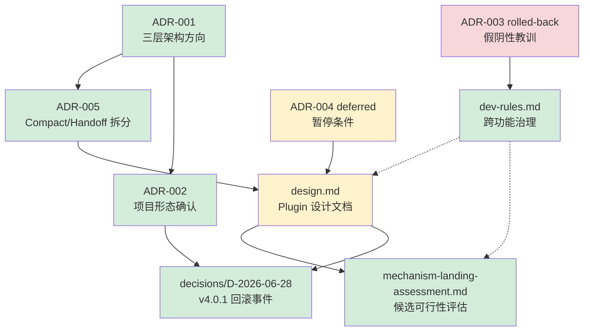

# 项目状态报告

> **生成日期**：2026-06-29
> **覆盖范围**：[dev-rules.md](dev-rules.md)、[plugin/design.md](plugin/design.md)、[plugin/audit/mechanism-landing-assessment.md](plugin/audit/mechanism-landing-assessment.md)、[decisions/D-2026-06-28-cline-v401-sdk-rollback.md](decisions/D-2026-06-28-cline-v401-sdk-rollback.md)
> **前置决策参考**：[ADR-001](decisions/adr/ADR-001-handoff-compact-memory.md)（Accepted）、[ADR-002](decisions/adr/ADR-002-project-shape.md)（active）、[ADR-004](decisions/adr/ADR-004-p5-spike-pause.md)（deferred）、[ADR-005](decisions/adr/ADR-005-split-compact-from-handoff.md)（Accepted）

---

## 一、背景

### 1.1 项目定位

本项目定位为 **Cline 扩展层**，在 Cline 原生能力之上构建自动化上下文管理、记忆注入、工具链治理等机制。核心判断依据来自 ADR-001：

- **73% 的任务为 resumed**（24/33 样本）——跨会话续作是主流场景，而非新会话启动
- **自研 compact 机制的 `compaction_count = 0`**——从未实际触发，存在必要性存疑
- **Cline 原生已具备自动上下文压缩能力**——与本项目自定义压缩层职责重叠
- **用户主要工作流在 Cline 内**——跨 IDE 迁移不是当前优先级

由此确定了三个方向（ADR-001 A+B'+D'）：复用 Cline 原生 Compact + 自动分级 Handoff + 可版本化索引层。后经 ADR-005 进一步拆分：Compaction 与 Handoff 解耦为独立机制。

### 1.2 两大产品线

当前项目并行推进两条产品线：

| 产品线 | 核心目标 | 关键机制 |
|--------|---------|---------|
| **search-orchestrator** | 搜索编排器：搜索质量治理与反-Bot 节流 | Goggle 过滤（P1）、三档引文（P3）、同源合并（P4）、MCP 节流 Wrapper（#24） |
| **Context Snapshot Plugin** | Plugin 形态的自动上下文管理 | messageBuilder 挂钩 compact 事件、rules 动态注入、index.jsonl 索引 |

本报告聚焦 Plugin 产品线（同时引用 dev-rules 作为全局治理约束），search-orchestrator 部分详见 `docs/search/`。

### 1.3 治理体系

[docs/dev-rules.md](dev-rules.md) 建立了跨功能的通用治理框架，不随任一功能开发期结束而删除：

- **执行主体边界**（§1）：明确哪些步骤必须由 Cline + SKILL 执行、TRAE agent 不得替代；Windows 环境必须用 PowerShell 做文件核查（§1.4）；证据分类体系和双来源验证要求（§1.5–§1.6）；minified 代码使用边界（§1.7）。
- **handoff 通用触发器**（§2）：仅在用户要求或特定条件（对话长+话题跳+上下文吃紧）下写入，写入后必须 git commit。
- **方向启动门控**（§4）：新大方向启动前必须明确载体/范围/排除/成功标准并请用户确认，防止调研范围漂移。
- **文件存放规范**（§5）与**状态值约定**（§3）。

该治理体系来源于历次事故教训（P5 Spike 假阴性误判、VS Code 扩展安装核查事故、CHANGELOG 单源错误结论等），强调"不在错误的层做错误的事"的同构原则。

---

## 二、关键决策

### 2.1 ADR-001：三层架构方向（Accepted，2026-06-15）

**决策**：采纳 A（复用 Cline 原生 Compact）+ B'（自动分级 Handoff）+ D'（可版本化索引层）三方向组合。

**关键事实支撑**：73% resumed 率、原生 compact 已存在、Handoff 设计已验证有效。

### 2.2 ADR-002：项目形态（active，2026-06-20）

**决策**：项目定义为 Cline 扩展层 L1/L2/L3 三层模型。经历三次更新（Update 1→2→3）逐次修正对 VS Code 扩展能力的理解，最终确认代码层有 `registerMessageBuilder` 注册系统 + 6 路径 skill 装载 + Windows `.ps1` hook。

### 2.3 ADR-003：P5 Plugin Spike 退出 → 当日撤销（rolled-back，2026-06-26）

**教训**：最初基于假阴性证据（`config plugins` 参数误解）下 No-Go 结论，当日纠正后回到 partial Go。这是推翻"阴性结论须先排除验证方法错误"规则的直接案例，最终催生了 dev-rules §1.3。

### 2.4 ADR-004：P5 Plugin Spike 暂停（deferred，2026-06-27）

**决策**：因实验环境(CLI)与生产环境(VS Code)错位，加上 CLI 载体不稳定（自动升级中断+bin 损坏+`run_commands` 崩溃），P5 暂停。

**恢复条件**：
1. ① CLI 载体稳定性恢复（后续评估不再需要——#5 已确认可在 VS Code 扩展直接可用）
2. ② 实验环境与生产环境对齐（当前状态：CLI 端满足，VS Code 端不满足）

### 2.5 ADR-005：Compaction 与 Handoff 拆分（Accepted）

**决策**：将 ADR-001 中的 #5 拆分为两个独立机制——**Context Snapshot**（窗口内压缩产物，Plugin 自动生成）与 **Handoff**（跨会话状态快照，用户手写）。本决策修正了 #5 的实现方式，并统一了后续文档的术语。

### 2.6 D-2026-06-28：v4.0.1 SDK 回滚事件

**事件**：2026-06-28，Cline VS Code Extension v4.0.1 发布——实质是**回滚到 3.89.2 pre-SDK 代码基**（版本号提升但代码倒退），修复 v4.0.0 引入的回归问题。SDK 迁移工作继续在 `main` 分支独立进行。

**影响**：
- ✅ v4.0.0 的 bootstrap 缺失问题在当前稳定版中不存在
- ⚠️ SDK 迁移分支上的 esbuild 配置问题未被修复，未来合入时**可能复发**
- ❌ VS Code 扩展 4.0.x 全系列不支持 Plugin 系统（v4.0.1/v4.0.2 无 plugin 代码）
- ✅ CLI 3.0.30+ 是当前唯一可用的 Plugin 运行环境

**附带发现**：CLI v3.0.31 新增 `plugin-bundled skills` 支持，与 skills-mcp-server 的长期方向有交集。

---

## 三、当前进度

### 3.1 治理体系（dev-rules.md）— ✅ 长期保留，冻结维护

| 组成部分 | 状态 | 说明 |
|---------|------|------|
| §1 执行主体边界（7 条款） | ✅ 已固化 | 覆盖执行环境、归档路径、阴性结论门控、证据治理、Windows 核查等 |
| §2 handoff 通用触发器 | ✅ 已固化 | 2 个触发条件已定，禁止无故写 handoff |
| §3 状态值约定 | ✅ 已固化 | 固定枚举，禁止发明新值 |
| §4 方向启动门控 | ✅ 已固化 | 新方向必须确认载体/范围/排除/成功标准 |
| §5 文件存放规范 | ✅ 已固化 | 按目录分类的硬性要求 |

维护策略：单一功能开发期间冻结，功能交界点回顾迁移。

### 3.2 Plugin 设计文档（design.md）— ⏳ 状态：proposed

| 组件 | 状态 | 说明 |
|------|------|------|
| 设计方向 | ✅ 已定稿 | compact-observer + 独立 snapshot 触发器 + rules 动态注入 |
| 术语统一（ADR-005）| ✅ 已完成 | "context snapshot" vs "handoff" 命名已落地 |
| 不可抗力声明 | ✅ 已记录 | VS Code 扩展 4.0.x 不支持 Plugin，所有验证在 CLI 端进行 |
| 开放问题 (Q1–Q5) | ✅ Q1–Q3 已解决 | Q4/Q5 待验证 |
| Phase 1（compact-observer）| ⏳ 待实施 | 验证 messageBuilder 在 compact 时可写文件 |
| Phase 2（snapshot 生成）| ⏳ 待实施 | 从 messages 提取结构化信息 |
| Phase 3（index.jsonl 集成）| ⏳ 待实施 | append-only 索引写入 |
| Phase 4（VS Code 端闭环）| ⏸ 推迟 | 等待 SDK 迁移重新合入稳定版 |

### 3.3 机制落地评估（mechanism-landing-assessment.md）— ✅ 已完成

**可直接复用 Cline 原生能力的候选**：

| 候选 | 覆盖机制 | 状态 |
|------|---------|------|
| #5 Context Snapshot | messageBuilder | ✅ 已验证 |
| #6 记忆注入 | rules 动态函数 + File Hooks TaskStart | ✅ 可落地 |
| #14 自研 compact | 已转向 Cline 原生 compact | ✅ 已转向 |

**需 Plugin 层实现的候选**：

| 候选 | 机制 | 状态 |
|------|------|------|
| #1 Terminal Watchdog（降级） | afterTool 耗时监控（不替代 Cline 进程管理） | ⚠️ 待实现 |
| #2–3 命令包装 | beforeTool 命令改写（PowerShell/UTF-8） | ⚠️ 待实现 |
| #4 Loop Guard | tool-call-recorder + beforeModel 提示词注入 + max iterations 兜底 | ⚠️ 待实现 |

**待验证/不可代码化**：

| 候选 | 状态 | 说明 |
|------|------|------|
| #7 Windows Hook | ❓ 待验证 | File Hooks Windows `.ps1` 支持查无实据 |

---

## 四、风险

### 4.1 技术风险

| # | 风险 | 可能性 | 影响 | 现状与缓解 |
|---|------|--------|------|-----------|
| R1 | **VS Code 扩展 Plugin 长期不可用** | 高 | 高——Phase 4 无法闭环 | SDK 迁移时间线未公布（GitHub issue #11944 待作者回复），CLI 端作为唯一运行环境先行验证（design.md 不可抗力声明已记录） |
| R2 | **SDK 迁移合入时 bootstrap 问题复发** | 中 | 中——影响 VS Code 端可用性 | D-2026-06-28 已记录根因（esbuild 配置），合入时需重新检查（相关证据链完备） |
| R3 | **Windows File Hooks 不支持 `.ps1`** | 中 | 中——#7 候选可能不可行 | 官方文档无 `.ps1` 证据，需实测验证；备选：用无扩展名可执行文件 |
| R4 | **snapshot 质量受限于 message 结构化提取** | 中 | 中——产出可能噪音大 | Phase 2 做提取精度迭代，先输出最小可用版本 |
| R5 | **`build()` 同步写文件可能阻塞对话流程** | 低 | 中 | 写入量很小（<10KB），同步阻塞可接受 |

### 4.2 治理风险

| # | 风险 | 说明 | 缓解 |
|---|------|------|------|
| R6 | **执行主体混淆**（TRAE agent 代跑 Cline 步骤） | dev-rules §1 明确边界，但需要持续执行 | 每次违反时回滚证据，交付提示词给用户在 Cline 中执行 |
| R7 | **阴性结论假阴性**（因验证方法错误下错误结论） | ADR-003 教训 | dev-rules §1.3 要求先对照验证方法有效性 |
| R8 | **Windows 核查工具假阴性**（Glob/LS 零命中但文件存在） | ADR-002 Update 2 事故 | dev-rules §1.4 强制使用 PowerShell `Get-ChildItem` |
| R9 | **单一证据源下错误结论**（CHANGELOG 回答"是否支持"等） | ADR-002 连续颠覆 | dev-rules §1.5–§1.6 要求分类验证和双来源独立验证 |
| R10 | **手写规则膨胀失控** | .clinerules + dev-rules 已有两层，再叠加功能 project-rules | 分层设计：`.clinerules`（执行行为）→ `dev-rules.md`（跨功能通用）→ `project-rules-<功能>.md`（功能专属），且 `dev-rules` 在功能开发期冻结 |

### 4.3 交付风险

| # | 风险 | 说明 | 缓解 |
|---|------|------|------|
| R11 | **CLI 载体稳定性** | ADR-004 暂停原因之一（自动升级中断+bin 损坏+崩溃） | 当前 CLI 3.0.33 实测稳定（v0.5.0 全链路加载成功），但仍需持续监控 |
| R12 | **Context Snapshot 与 Handoff 的用户心智模型混淆** | ADR-005 已拆分概念但用户可能混淆 | 术语约定已落地：snapshot=自动产物，handoff=手写文档，在文档中一贯使用 |
| R13 | **Phase 1–3 依赖 CLI 端验证，VS Code 端可用性待定** | 核心功能可能只在 CLI 端可用 | 设计文档已记为不可抗力，Phase 4 标记为"推迟"直到 SDK 迁移重新合入 |

---

## 附录：文档关系图

### 引用锚

| 文件 | 路径 | 关键章节 |
|------|------|---------|
| 跨功能治理规则 | [dev-rules.md](dev-rules.md) | §1 执行边界、§1.4 Windows 核查、§1.5–1.6 证据治理、§4 方向门控 |
| Plugin 设计 | [plugin/design.md](plugin/design.md) | 不可抗力声明、§3 实现策略、§4 Phases、§8 Open Questions |
| 机制落地评估 | [plugin/audit/mechanism-landing-assessment.md](plugin/audit/mechanism-landing-assessment.md) | §1 API 能力表、§3 落地评估矩阵、§4 推荐实施顺序 |
| v4.0.1 回滚 | [decisions/D-2026-06-28-cline-v401-sdk-rollback.md](decisions/D-2026-06-28-cline-v401-sdk-rollback.md) | 影响分析表、未来风险 |
| 所有决策索引 | [decisions/README.md](decisions/README.md) | — |

